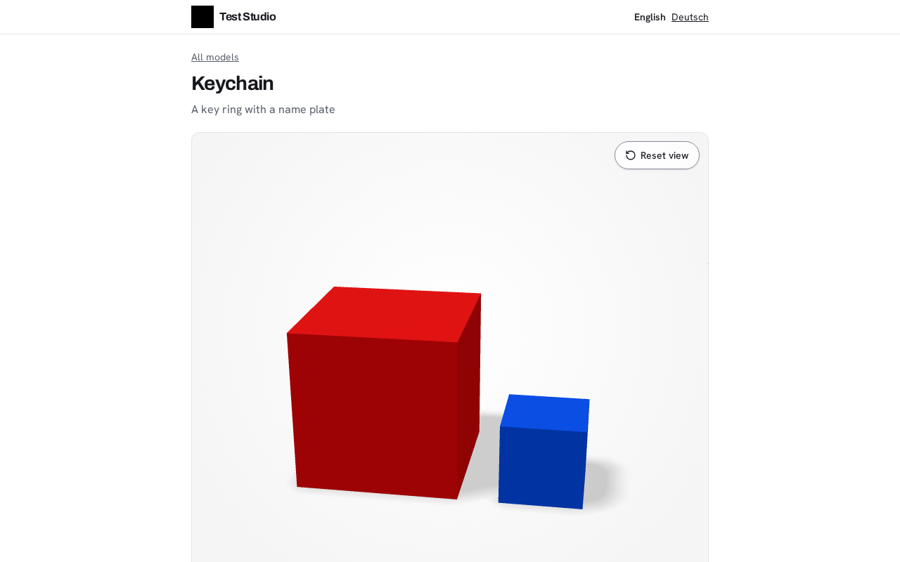
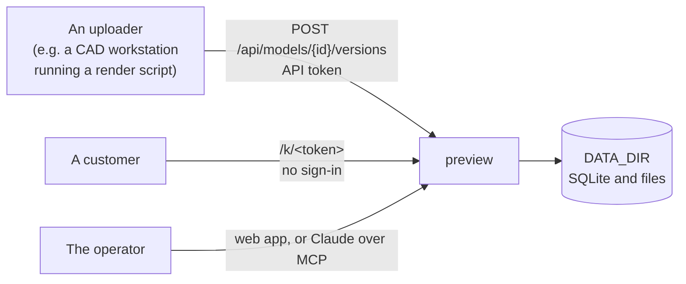

# preview

View-only 3D previews of your models for your customers. A workshop uploads each version of a model (a 3MF, a preview image, optional drawings); every customer gets one secret link to a page with their models, where they turn and zoom each one in 3D, see its versions with their notes, and can't download it. Customers need no account; you revoke or renew a link at any time.



preview is one Next.js app in one Docker image, on [next-app-kit](https://github.com/Marceltov/next-app-kit), which brings the sign-in, API tokens, MCP, REST, migrations and uploads. Its data is two SQLite files and the uploaded files, in one directory.

## Running it

With Docker Compose, behind a reverse proxy that terminates TLS:

```sh
mkdir preview && cd preview
curl -fsSLO https://github.com/3D-Bruckner/preview/raw/main/compose.yaml
curl -fsSL -o .env https://github.com/3D-Bruckner/preview/raw/main/.env.example
chmod 600 .env    # then fill it in: PUBLIC_URL, PREVIEW_SECRET, PREVIEW_ALLOWED_EMAILS, a way to sign in
docker compose up -d
```

It listens on `127.0.0.1:3000`; point your reverse proxy there. `/health` answers `{"status":"ok"}` once it runs.

## Settings

Every setting is an environment variable in `.env`; [`docs/configuration.md`](docs/configuration.md) lists them all, with the data directory and what a backup needs. The ones that make it yours:

- `PREVIEW_BRAND_NAME`, `PREVIEW_BRAND_URL`: your name in the header and the title, and where it links to.
- `PREVIEW_ACCENT_COLOR`: your colour, as hex.
- `PREVIEW_LOGO`: your logo, an SVG or PNG inside the data directory.
- `PREVIEW_IMPRINT_URL`, `PREVIEW_PRIVACY_URL`: the footer's links on every page (operators in Germany need both).

The pages speak German and English, German by default; a visitor can switch.

## How it fits together



An uploader sends each new version; a customer opens their secret link; the operator manages customers and models in the web app or through Claude. More in [architecture](docs/architecture.md).

## The workflow

1. The operator creates a customer (the web app, or `create_customer` over MCP) and gets their link, `<PUBLIC_URL>/k/<token>`, and adds a model to them.
2. An uploader sends a version of the model: the 3MF, a preview image, optional drawings and a note. The customer sees it on their link at once.
3. The customer turns and zooms the model in 3D, reads the versions' notes and looks at the drawings. They can't download anything. The operator renews or revokes the link at any time.

## Uploading a version

An uploader (a script, for example one on a CAD workstation that renders each change) needs an API token with scope `read+write`: make one on the settings page, over MCP (`create_api_token`), or on the server ([configuration](docs/configuration.md#the-image)). Then one request per version, as multipart form data:

```sh
curl -fsS https://preview.example.com/api/models/<model-id>/versions \
  -H "Authorization: Bearer $PREVIEW_TOKEN" \
  -F model=@part.3mf \
  -F preview=@part.png \
  -F drawing=@front.svg -F drawing=@side.pdf \
  -F note="Wall thickness 2 mm"
```

`model` (one 3MF) and `preview` (one PNG) are required, `drawing` takes 0 to 10 PNG, SVG or PDF files, `note` is text. The answer is `201` with `{"id", "number", "note", "link"}`, `link` being the model's page for its customer; a refusal is `{"error"}` in the request's language. A request may carry up to `PREVIEW_MAX_UPLOAD_MB` (100) in all. Everything else (customers, models, versions' lists, tokens) is the REST API at `/api/v1`, described at `<PUBLIC_URL>/api/v1/openapi.json` (committed as [`openapi.json`](openapi.json)), and Claude manages it over MCP at `<PUBLIC_URL>/mcp` ([the tools](docs/mcp.md)).

## Developing

Node 26 (`.nvmrc`):

```sh
nvm use && npm ci
cat > .env.local <<'ENV'
PUBLIC_URL=http://localhost:3000
PREVIEW_SECRET=a-development-secret-of-at-least-32-characters
DATA_DIR=./data
PREVIEW_DEV_USER=you@example.org
ENV
npm run dev            # http://localhost:3000, signed in as PREVIEW_DEV_USER
```

`PREVIEW_DEV_USER` skips the sign-in in development (refused in production; it can't make API tokens or MCP connections); set `PREVIEW_SMTP_URL` instead to sign in by mail. The checks CI runs:

```sh
npm run format:check && npm run lint && npm run typecheck && npm test && npm run test:e2e && npm run build && npm run generate -- --check
```

How it is built: [architecture](docs/architecture.md); why: [ADR 0001](docs/adr/0001-a-viewer-of-our-own.md); another language: [adding a language](docs/adding-a-language.md).

## Licence

AGPL-3.0-only ([`LICENSE`](LICENSE)). Contributions from outside need the [contributor licence agreement](CLA.md) ([`CONTRIBUTING.md`](CONTRIBUTING.md)); vulnerabilities are reported as [`SECURITY.md`](SECURITY.md) says.
