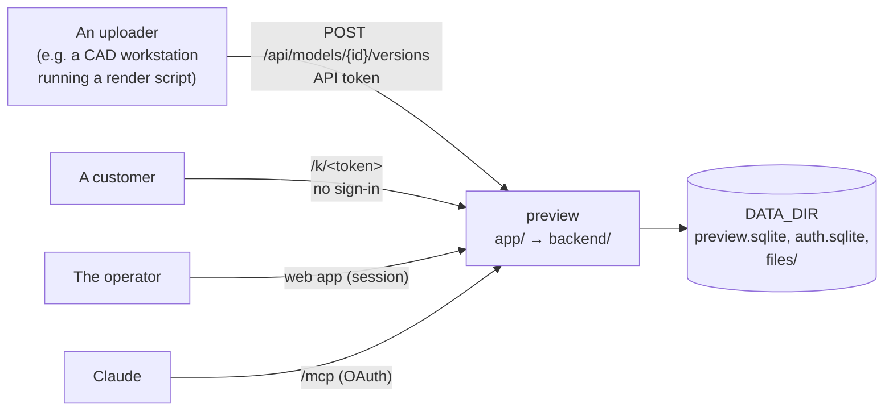

# Architecture

How preview is put together: where each part lives and the rules between them. Why it is built this way is in [ADR 0001](adr/0001-a-viewer-of-our-own.md); the settings and the data directory are in [configuration](configuration.md).

Everything reaches the same domain code in `backend/`; the three ways in differ only in who is allowed: an API token or the operator's session uploads, a link token opens one customer's pages, and the operator or Claude manages the rest.

## Layers

- `app/` (pages under `app/[lang]/`, route handlers outside it), `components/`, `backend/` (the framework-free domain), `e2e/`.
- The frontend (`app/`, `components/`, `proxy.ts`, `instrumentation.ts`) imports the backend only through `@/backend` (`backend/index.ts`), or `@/backend/client` in the browser; `backend/` never imports Next.js, React or the frontend. ESLint's `@typescript-eslint/no-restricted-imports` enforces both.
- The data layer is `backend/db/`: it alone holds `better-sqlite3`, `kysely` (types excepted elsewhere), the connection (`connection.ts`), the schema types (`schema.ts`), the migrations (`migrations.ts`, run by the kit's `migrate`) and every query (one file per table group, joined into the `Store` in `store.ts`). Everything else takes it from `backend/db/index.ts`; ESLint enforces it. One instance per workshop: no tenant scope.
- `backend/runtime.ts`: the `Runtime` (config, `store`, clock, fetch, log, sign-in's `signIn`, `auth()`, `person`, `apiCaller`). The process's is `runtime()` from `app/_lib/runtime.ts`, which hands `backend/index.ts`'s `runtime(mail)` the sign-in mail's words and language pick from the copy modules (backend never imports the frontend). It lives on `globalThis`, so `next.config.ts` keeps next-app-kit in `serverExternalPackages` (one copy of the kit for instrumentation and every route).
- Domain code reaches the database only through `rt.store` (kysely builds the queries, better-sqlite3 runs them synchronously). A mutation runs in `mutation(rt, fn)`: one transaction, rolled back on a refusal.
- Domain functions return an `Outcome` (`backend/outcome.ts`): the value, or `not_found` / `invalid` / `conflict` (REST 404/400/409) with an English message.

## A version's facts

`backend/threemf/` reads a 3MF's **facts** at upload: its parts and filament slots, never its meshes. A Bambu Studio project says per object which filament each of its parts prints in (`Metadata/model_settings.config`) and lists the slots (`Metadata/project_settings.config`, JSON); an object whose parts print in several filaments is one part per filament (key `<objectId>:<n>`). A plain 3MF gives one part per object, coloured by its base material or colour group. Entries are found in the zip's central directory and inflated piece by piece with a bound (16 MiB for the configs, 1 GiB for the root model, which is scanned as a stream by an attributes-only tag scanner, `xml.ts`); nothing under `3D/Objects/` is read on the server. The facts are JSON in `versions.facts`; a version stored before they existed, or read by an older reader (`READER`), is read at the next start (`fillMissingFacts`, from `instrumentation.ts`, logging the counts), and `reread_facts` reads one again.

## Print figures and the slicer

A version's print figures (time, weight and grams per filament, for the whole model) come from one of two places. A 3MF that Bambu Studio sliced carries them in `Metadata/slice_info.config`, per plate, from the operator's own profiles; the facts read them, summed over the plates (`figures`, READER 2). Any other 3MF is the slicing service's (`PREVIEW_SLICER_URL`): `backend/slicer.ts` runs in the server's process (started from `instrumentation.ts`), gives every version without figures a job in `slice_jobs`, and works the due ones one at a time, posting the 3MF to the service's `POST /estimate`. A busy or limited service (429, 5xx, a timeout, no answer) is asked again after 5, 10, 15 and 30 minutes; any other refusal is final, with the service's reason, and the operator can ask again (`reslice_version`, "Neu berechnen"). The service's answer stays in `slice_jobs`, apart from the facts, so reading a 3MF again never loses it. `backend/figures.ts` answers both the same way, with their `source`; the customer's page shows "wird berechnet" while a job is pending and nothing when it failed.

## The 3D view and the parts

The customer's model page draws the version's 3MF with three's `ThreeMFLoader`, in the browser (`components/viewer/scene.ts`). We keep its loader instead of a parser of our own because its output follows the file closely enough to name every mesh: one child of the root per build item, in order; in an object made of components one child per component, in order; a mesh object a group of its meshes (checked against a plain 3MF, the fixtures and a 42-mesh Bambu project). `components/viewer/parts.ts` walks that tree with the facts' item list and component indices, names each mesh by its part's key, gives it its slot's colour (vertex colours stay) and drops what no part claims (a modifier, a negative part, a support blocker). Facts with no parts (a version not read yet) leave every mesh in the loader's colours.

`components/ModelReview.tsx` holds what the visitor picked: the part shown alone (focus fits the camera to it), the hidden ones (the eye), the one under the pointer or keyboard focus (lit up in the accent colour) and the size of what is shown. The view reports that size (`onSize`); the Maße card and the chip over the view show it, so the measurements are always of what is on screen. Plates are not shown: a customer reviews parts and colours, not how they are laid out for printing.

## Filaments and feedback

The operator keeps one list of **filaments** (`backend/filaments.ts`, table `filaments`: name, material, colour, offered or not, position), edited in the web app's settings and over MCP and REST. The customer's model page offers the offered ones as a picker per part ("wie im Entwurf" keeps the file's colour); `ModelReview` holds the picks, the view recolours the part (`View.setColour`), and the picks reach the Rückmeldung card through `components/Wishes.tsx`. With no filaments the page has no pickers and the card takes a comment only. The Druck card names a file's filament after the list's entry with exactly its colour and material.

**Feedback** (`backend/feedback.ts`, table `feedback`) is a comment (≤ 2000 characters) and colour wishes on one version. The customer's page sends it through its route's server action, and `sendFeedback` starts from `customerByToken`, like every customer read: another customer's model or an unknown version is refused like a missing one. Each wish is checked against the version's parts and the filaments on offer, and keeps a copy of its filament, so a later delete loses nothing. A customer may send 10 an hour and 50 a day (`limited`, REST 429). With `PREVIEW_FEEDBACK_EMAIL` set the operator gets a mail in German (`backend/mail.ts`, the sign-in mail's SMTP settings). A failed mail is logged by its error code only and loses nothing. The web app lists it under its version; opening the model marks it seen, and the start page lists what is unseen. MCP and REST serve the same as `list_feedback` and `mark_feedback_seen`.

## The brand

`backend/config.ts` reads the brand of whoever runs the instance (`config.brand`: name, link, accent colour, logo, imprint and privacy links); the product has neutral defaults and names no operator. `app/[lang]/layout.tsx` puts the name in the title and the accent on `<html>` as `--brand-accent` (`app/globals.css` derives the hover and the dark mode's form from it), and every page's footer links the imprint and the privacy policy when they are set (`components/BrandFooter.tsx`). The headers show the name (`components/BrandName.tsx`), linked when a brand URL is set.

## Surfaces

- **MCP** (`backend/mcp.ts`, route `app/mcp/route.ts`): the kit's tools over the same domain functions, one per REST operation (`checkOpsMirrorTools` in `rest.test.ts`). Descriptions say what Claude needs before a call; each result's `guidance` (English, built from what the call did) what matters after it. The tools: [docs/mcp.md](mcp.md).
- **REST** (`backend/rest.ts`): the kit's table of operations under `/api/v1` (route `app/api/v1/[...path]`, `/api/v1/openapi.json`, the committed `openapi.json`). Each operation names the MCP tool it mirrors, or says why none. Tokens are made and revoked in the web app or by an OAuth caller, never with an API token (403; the kit's `caller.kind`).
- **The customer pages** (`app/[lang]/(customer)/k/[token]/`, no sign-in): a customer's models as tiles (`/k/<token>`) and a model's 3D view, versions, drawings and the Rückmeldung card (`/k/<token>/<model>`; its one write, feedback, is the route's server action), read through `backend/customerview.ts`, which starts every read from `customerByToken` and reaches models, versions and files only through that customer. Their files come from `app/k/[token]/files/[version]/[file]` (outside the proxy; inline, private, `nosniff`, sandboxed by their CSP, never indexed), the logo from `app/brand/logo` (its real path checked to lie inside `DATA_DIR`, `backend/brand.ts`). No download, no link to the 3MF, no cookie but the language and theme switches' (each set only when the visitor uses it); `proxy.ts` opens them in the customer's language and marks them `noindex`. A token that opens nothing and an id that isn't the customer's answer `notFound()`, rendered by `app/[lang]/not-found.tsx` like `app/global-not-found.tsx` (`components/NotFound.tsx`, the head from `app/_lib/document.ts`).
- **The web app** (`app/[lang]/(app)/`, phone first): the start page (new feedback, the customers) and the settings (filaments, API tokens). Its server actions (`actions.ts`) check the person and call `@/backend`. Shared pieces in `components/` (icons from `components/icons.tsx`, classes in `ui.ts`, `Dialog`, `Tabs`). Sign-in and consent are in `app/[lang]/(public)/`.

## Languages

German and English (`components/copy/de.ts`, `components/copy/en.ts`, the reference typed as `Copy`); `copy.test.ts` checks that both have the same keys. `proxy.ts` picks the language (the switch's cookie `preview_lang`, then `Accept-Language`, then German) and rewrites each page to `app/[lang]/`; no URL carries it. Route handlers stay outside the proxy's matcher and call `languageOf(req.headers)` themselves.

## Sign-in

Sign-in, API tokens, MCP, REST, migrations and multipart come from next-app-kit; nothing it provides is copied here. `backend/accounts.ts` wires sign-in (prefix `PREVIEW`, token prefix `preview_`, pages `/signin` and `/consent` under `app/[lang]/`); the ways in are whatever the settings configure (a code by mail, any OIDC provider). The route files under `app/api/auth`, `app/.well-known` and `app/api/test/sign-in` are one line each over the kit's handlers. Pages that need someone signed in call `requirePerson(path)` (`app/_lib/signin.ts`); e2e tests sign in through the kit's test route (`e2e/signin.ts`).

## Logs

pino (`backend/log.ts`), JSON on stdout, English; never a token, a link token, a file's name, an email address or a feedback's comment.
