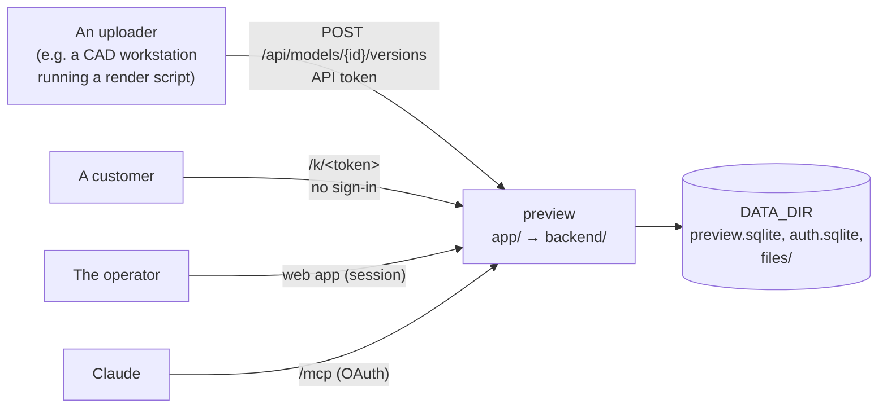

# Architecture

How preview is put together: where each part lives and the rules between them. Why it is built this way is in [ADR 0001](adr/0001-a-viewer-of-our-own.md); the settings and the data directory are in [configuration](configuration.md).

Everything reaches the same domain code in `backend/`; the three ways in differ only in who is allowed: an API token or the operator's session uploads, a link token opens one customer's pages, and the operator or Claude manages the rest.

## Layers

- `app/` (pages under `app/[lang]/`, route handlers outside it), `components/`, `backend/` (the framework-free domain), `e2e/`.
- The frontend (`app/`, `components/`, `proxy.ts`, `instrumentation.ts`) imports the backend only through `@/backend` (`backend/index.ts`), or `@/backend/client` in the browser; `backend/` never imports Next.js, React or the frontend. ESLint's `@typescript-eslint/no-restricted-imports` enforces both.
- The data layer is `backend/db/`: it alone holds `better-sqlite3`, `kysely` (types excepted elsewhere), the connection (`connection.ts`), the schema types (`schema.ts`), the migrations (`migrations.ts`, run by the kit's `migrate`) and every query (one file per table group, joined into the `Store` in `store.ts`). Everything else takes it from `backend/db/index.ts`; ESLint enforces it. One instance per workshop: no tenant scope.
- `backend/runtime.ts`: the `Runtime` (config, `store`, clock, fetch, log, sign-in's `signIn`, `auth()`, `person`, `apiCaller`). The process's is `runtime()` from `app/_lib/runtime.ts`, which hands `backend/index.ts`'s `runtime(mail)` the sign-in mail's words and language pick from the copy modules (backend never imports the frontend). It lives on `globalThis`, so `next.config.ts` keeps next-app-kit in `serverExternalPackages` (one copy of the kit for instrumentation and every route).
- Domain code reaches the database only through `rt.store` (kysely builds the queries, better-sqlite3 runs them synchronously). A mutation runs in `mutation(rt, fn)`: one transaction, rolled back on a refusal.
- Domain functions return an `Outcome` (`backend/outcome.ts`): the value, or `not_found` / `invalid` / `conflict` (REST 404/400/409) with an English message.

## The brand

`backend/config.ts` reads the brand of whoever runs the instance (`config.brand`: name, link, accent colour, logo, imprint and privacy links); the product has neutral defaults and names no operator. `app/[lang]/layout.tsx` puts the name in the title and the accent on `<html>` as `--brand-accent` (`app/globals.css` derives the hover and the dark mode's form from it), and every page's footer links the imprint and the privacy policy when they are set (`components/BrandFooter.tsx`). The headers show the name (`components/BrandName.tsx`), linked when a brand URL is set.

## Surfaces

- **MCP** (`backend/mcp.ts`, route `app/mcp/route.ts`): the kit's tools over the same domain functions, one per REST operation (`checkOpsMirrorTools` in `rest.test.ts`). Descriptions say what Claude needs before a call; each result's `guidance` (English, built from what the call did) what matters after it. The tools: [docs/mcp.md](mcp.md).
- **REST** (`backend/rest.ts`): the kit's table of operations under `/api/v1` (route `app/api/v1/[...path]`, `/api/v1/openapi.json`, the committed `openapi.json`). Each operation names the MCP tool it mirrors, or says why none. Tokens are made and revoked in the web app or by an OAuth caller, never with an API token (403; the kit's `caller.kind`).
- **The customer pages** (`app/[lang]/(customer)/k/[token]/`, no sign-in): a customer's models as tiles (`/k/<token>`) and a model's 3D view, versions and drawings (`/k/<token>/<model>`), read through `backend/customerview.ts`, which starts every read from `customerByToken` and reaches models, versions and files only through that customer. Their files come from `app/k/[token]/files/[version]/[file]` (outside the proxy; inline, private, `nosniff`, sandboxed by their CSP, never indexed), the logo from `app/brand/logo` (its real path checked to lie inside `DATA_DIR`, `backend/brand.ts`). No download, no link to the 3MF, no cookie but the language switch's; `proxy.ts` opens them in the customer's language and marks them `noindex`. A token that opens nothing and an id that isn't the customer's answer `notFound()`, rendered by `app/[lang]/not-found.tsx` like `app/global-not-found.tsx` (`components/NotFound.tsx`, the head from `app/_lib/document.ts`).
- **The web app** (`app/[lang]/(app)/`, phone first): the start page and the settings (API tokens). Its server actions (`actions.ts`) check the person and call `@/backend`. Shared pieces in `components/` (icons from `components/icons.tsx`, classes in `ui.ts`, `Dialog`, `Tabs`). Sign-in and consent are in `app/[lang]/(public)/`.

## Languages

German and English (`components/copy/de.ts`, `components/copy/en.ts`, the reference typed as `Copy`); `copy.test.ts` checks that both have the same keys. `proxy.ts` picks the language (the switch's cookie `preview_lang`, then `Accept-Language`, then German) and rewrites each page to `app/[lang]/`; no URL carries it. Route handlers stay outside the proxy's matcher and call `languageOf(req.headers)` themselves.

## Sign-in

Sign-in, API tokens, MCP, REST, migrations and multipart come from next-app-kit; nothing it provides is copied here. `backend/accounts.ts` wires sign-in (prefix `PREVIEW`, token prefix `preview_`, pages `/signin` and `/consent` under `app/[lang]/`); the ways in are whatever the settings configure (a code by mail, any OIDC provider). The route files under `app/api/auth`, `app/.well-known` and `app/api/test/sign-in` are one line each over the kit's handlers. Pages that need someone signed in call `requirePerson(path)` (`app/_lib/signin.ts`); e2e tests sign in through the kit's test route (`e2e/signin.ts`).

## Logs

pino (`backend/log.ts`), JSON on stdout, English; never a token, a link token, a file's name or an email address.
